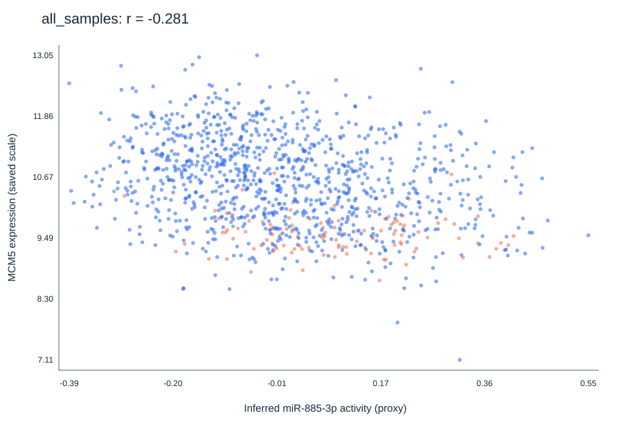

# circRNA regulation in non-small cell lung cancer

I started this bioinformatics study the summer after my freshman year of high
school. The project examined the proposed circFNDC3B–miR-885-3p–MCM5 regulatory
axis in non-small cell lung cancer, using CircNet, GEPIA2, TCGA data, and GSVA.

This repository brings together my paper, presentation, original R scripts, and
saved results. It also includes a newer Python analysis that checks the saved
data and reproduces the reported correlation. The original study is complete;
reproducing every step from the raw data is still in progress.

## Start here

1. Read [the source audit](results/AUDIT.md).
2. Review [what is reproduced and what is not](docs/REPRODUCTION_STATUS.md).
3. Run the commands below, then compare the generated figures with the paper.
4. Continue into the linked [ML extension](https://github.com/sahilnpatel/nsclc-rna-ml).

## What the saved data show

- 1,129 samples: 1,017 primary tumor, 110 solid-tissue normal, two recurrent tumor.
- Correctly joined all-sample Pearson correlation: **−0.280910**, matching the paper's
  rounded **−0.281**. Primary-tumor-only correlation: **−0.248850**.
- The later ML spreadsheet independently sorted MCM5 and lost sample matching.
  Its 1,000 rows are not a valid biological feature table.
- The inferred miRNA activity is a negated target-gene enrichment score. It is not
  measured miRNA expression. Its 74-gene signature includes MCM5, creating a
  dependency that must be addressed in follow-up work.



Blue: primary tumor. Orange: normal tissue. Green: recurrent tumor.

## Run

The source audit needs only Python's standard library:

```bash
python3 scripts/audit.py
```

For statistical comparisons and figures, follow [environment setup](docs/ENVIRONMENT.md), then:

```bash
python scripts/analyze_saved_outputs.py
python -m pytest tests -q
```

Optional modern GSVA rerun, after installing R and Bioconductor GSVA:

```bash
Rscript scripts/recompute_gsva.R /path/to/TCGA.LUNG.sampleMap_HiSeqV2.txt recomputed
```

The R script is prepared but has not been run. It uses `gsvaParam` and records
gene-set coverage and package versions. It also recomputes the target signature
without MCM5, an important follow-up check. The original GSVA package versions
and browser-based GEPIA2 survival analyses have not been reproduced.

## Files

| Folder | Contents |
|---|---|
| `archive/code` | Original R scripts, including historical errors |
| `archive/paper` | Supplied paper and presentation versions |
| `archive/gene_sets` | Original gene-set files and additional score workbooks |
| `data/source` | Small source exports required to reproduce the audit |
| `data/processed` | Sample-ID-aligned tables generated by the audit |
| `scripts` / `src` | New reproducible analysis and strict readers |
| `results` | Regenerated tables, audit, and figures |
| `docs` | Provenance, scope, limitations, and learning guidance |
| `tests` | Sample alignment and statistical regression checks |

See [source hashes](docs/source_manifest.json), [credit and rights](docs/RIGHTS_AND_CREDIT.md),
and [references](docs/REFERENCES.md). Correlation and computational prediction do
not establish a causal mechanism or clinical utility.
